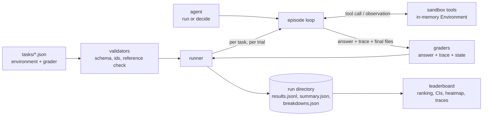

# Architecture

## Modules (`src/open_agent_eval/`)

| Module | Responsibility |
|---|---|
| `schemas.py` | `TaskSpec`, `GraderSpec`; parsing and strict validation of task JSON |
| `validators.py` | Directory-level validation: layout, duplicate ids, reference answer passes its own grader |
| `tools.py` | Seven deterministic tools over an in-memory `Environment`; `TOOL_SPECS` is the single source for tool schemas sent to model APIs |
| `episode.py` | `run_episode`: ask the agent for one action, execute it, record a `TraceStep`, enforce `max_steps` |
| `graders.py` | Answer graders (`exact`, `contains`, `json`) plus `grade_trace` (required, ordered, forbidden calls; final files) |
| `agents.py` | Agent protocol, baselines, OpenAI/Anthropic adapters with native tool-calling loops, import-path plugin loader |
| `policies.py` | Offline agents: `oracle`, `keyword-retriever`, `random` |
| `runner.py` | Trials, per-task results, summaries, breakdowns, artifact writing |
| `stats.py` | Wilson and bootstrap intervals |
| `leaderboard.py` | Static HTML/Markdown/JSON leaderboard and trace viewer |
| `profiles.py`, `api.py`, `cli.py` | Profile execution, stable Python API, command line |

## Lifecycle of one episode

1. The runner builds a fresh `Environment` from the task fixture. Nothing is shared between tasks or trials.
2. The agent's `decide(task, history)` returns a `ToolCall` or a `FinalAnswer`.
3. A tool call is executed by the sandbox. Invalid calls (unknown tool, tool not enabled for this task, bad
   arguments) become error observations so the agent can recover.
4. The loop ends on a final answer or when `max_steps` is exhausted. An exhausted budget is a failed attempt
   with an empty response.
5. Grading combines the answer check with the trace and sandbox state. All checks must pass; the score is 0 or 1.

## Artifacts

A run writes `results/<run-id>/`:

- `config.json` run configuration and selected task ids
- `results.jsonl` one record per task attempt, including the full trace and trial index
- `summary.json` pass rate, 95% Wilson interval, bootstrap score interval, steps, latency
- `categories.json`, `breakdowns.json` per category, difficulty and grader type

`benchmarks/published/` holds the committed baseline runs; `scripts/publish_baselines.sh` regenerates them and
`scripts/check_snapshot.py` verifies that the committed outcomes and traces still match the code.
